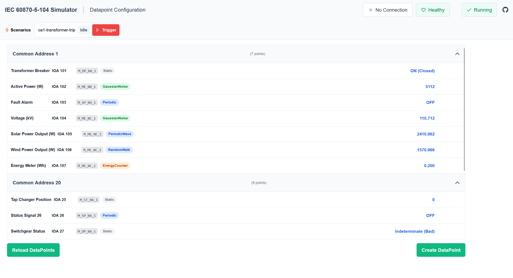
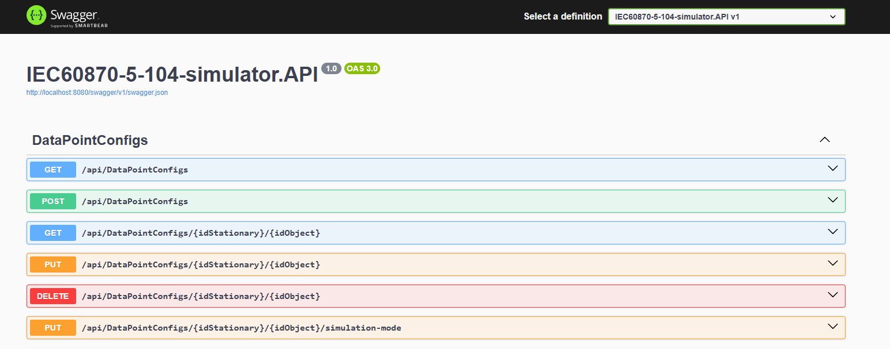
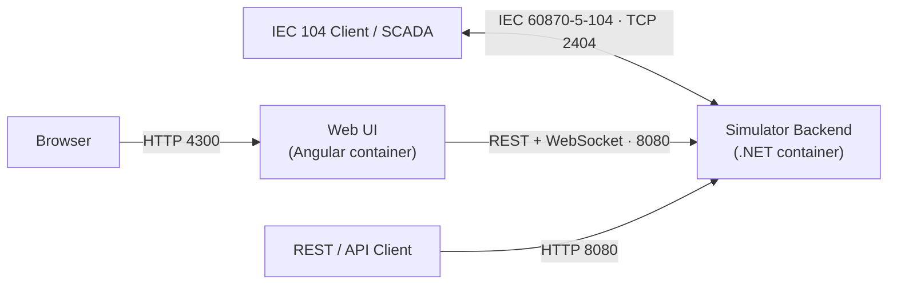

<div align="center">

# IEC 60870-5-104 Simulator

**A cloud-native IEC 60870-5-104 outstation simulator for testing SCADA clients — with REST API, real-time web UI, and fault-scenario engine.**

[](LICENSE)
[](https://github.com/RichyP7/IEC60870-5-104-simulator/actions/workflows/docker-image.yml)
[](https://github.com/RichyP7/IEC60870-5-104-simulator/actions/workflows/vulnerability-scan.yml)
[](https://dotnet.microsoft.com/)
[](simulation-ui/IEC-104-UI)
[](https://github.com/RichyP7/IEC60870-5-104-simulator/pkgs/container/iec60870-5-104-simulator)

 <sup>[1](#myfootnote1)</sup>

[Quickstart](#-quickstart) •
[Features](#-features) •
[Configuration](#%EF%B8%8F-configuration) •
[REST API](#rest-api) •
[SCADA Demo](#-scada-demo) •
[Contributing](#-contributing)

</div>

---

## Overview

This simulator acts as an **IEC 60870-5-104 server (controlled station / outstation)** listening on TCP port `2404`, so any IEC 104 client can connect and interact with it. It is built as a containerized .NET application for cloud-native OT test scenarios.

Whether you're testing a SCADA system, developing a new IEC 104 client, or learning the protocol — this simulator gives you a realistic, scriptable outstation in seconds.

Built on top of [lib60870.NET](https://github.com/mz-automation) by mz-automation.

<!-- SCREENSHOT: Web UI overview here -->


<details>
<summary><b>What is IEC 60870?</b></summary>

> In electrical engineering and power system automation, the International Electrotechnical Commission 60870 standards define systems used for telecontrol (supervisory control and data acquisition). Such systems are used for controlling electric power transmission grids and other geographically widespread control systems. By use of standardized protocols, equipment from many different suppliers can be made to interoperate. — *Wikipedia*

</details>

## ✨ Features

- 🖧 **Full IEC 104 outstation** — measurements, commands, general interrogation, counter interrogation
- 📈 **Realistic simulation modes** — GaussianNoise, PeriodicWave, RandomWalk, EnergyCounter, Profiles, and more
- ⚡ **Fault scenario engine** — timed multi-step fault sequences with automatic recovery, triggered via REST
- 🌐 **REST API + Swagger** — configure datapoints and control the engine at runtime
- 🔄 **SignalR real-time push** — live datapoint values, scenario status, and client count over WebSocket
- 🖥️ **Angular web UI** — configure and monitor the simulator in your browser
- 🐳 **Container-first** — prebuilt image on GHCR, docker-compose setup, health checks for Kubernetes

## 🚀 Quickstart

### Option A: Docker / Podman (no toolchain needed)

```bash
docker run -p 2404:2404 -p 8080:8080 ghcr.io/richyp7/iec60870-5-104-simulator:main
# or
podman run -p 2404:2404 -p 8080:8080 ghcr.io/richyp7/iec60870-5-104-simulator:main
```

With the web UI included (backend on 2404 + 8080, UI on 4300):

```bash
docker compose up
```

Build the image yourself:

```bash
docker build -t iec104-simulator .
docker run -p 2404:2404 -p 8080:8080 iec104-simulator
```

### Option B: Run locally from source

**Prerequisites:** [.NET 10 SDK](https://dotnet.microsoft.com/download/dotnet/10.0) · [Node.js 22 LTS](https://nodejs.org/) (web UI only)

```bash
# 1. Start the simulator backend
dotnet run --project src/IEC60870-5-104-simulator.API

# 2. (Optional) Start the web UI in a second terminal
cd simulation-ui/IEC-104-UI
npm ci
npm start   # → http://localhost:4200 (CORS pre-configured in dev mode)
```

### Connect

| Endpoint | Address |
|----------|---------|
| IEC 104 server | `localhost:2404` |
| REST API | `http://localhost:8080/api/` |
| Swagger UI | `http://localhost:8080/swagger` (development mode) |
| SignalR hub | `ws://localhost:8080/hubs/simulation` |



### Evaluate with the built-in test client

If you don't have a SCADA/IEC-104 master at hand, a minimal console test client is included to inspect what the simulator actually sends on the wire — useful for verifying your datapoint configuration:

```bash
# Simulator must be running (see above), then in a second terminal:
dotnet run --project src/Tests/IEC60870-5-104-simulator.TestClient            # connects to 127.0.0.1:2404
dotnet run --project src/Tests/IEC60870-5-104-simulator.TestClient 10.0.0.5 2404   # or a custom host/port
```

On connect it sends a general interrogation (so you immediately see all configured points) and then prints every received value in one line per information object:

```
12:09:30.321 | PERIODIC                | M_SP_NA_1  | CA   20 | IOA    57 | OFF (false)  [GOOD]
12:09:30.324 | PERIODIC                | M_ME_NC_1  | CA    1 | IOA   104 |     108.423  [GOOD]
12:10:09.740 | INTERROGATED_BY_STATION | M_DP_NA_1  | CA    1 | IOA   101 |          ON  [GOOD]
```

Columns: local receive time · cause of transmission · IEC type · common address · information object address · value · quality (and the sender timestamp for time-tagged types). Press `Q` or `Ctrl+C` to quit.

## 🏗 Architecture

<details>
<summary><b>System architecture</b></summary>



> 📖 A detailed internal architecture diagram is available in **[docs/architecture.md](docs/architecture.md)**.

</details>

## ⚙️ Configuration

### Datapoint Configuration

Datapoints are configured in `Configuration/SimulationOptions.json`. Each measure defines a Common Address (`Ca`), Object Address (`Oa`), and `TypeId` corresponding to an IEC 60870-5-104 data type.

```json
{
  "Iec104Simulation": {
    "CycleTimeMs": 5000,
    "DataPointConfiguration": {
      "Measures": [
        {
          "Id": "CA20_IOA25",
          "Name": "Tap Changer Position",
          "Ca": "20",
          "Oa": "25",
          "TypeId": 5,
          "Mode": "Periodic"
        }
      ],
      "Commands": [
        {
          "Id": "CA20_IOA2",
          "Name": "Tap Changer Command",
          "Ca": "20",
          "Oa": "2",
          "TypeId": 47,
          "ResponseId": "CA20_IOA25"
        }
      ]
    }
  }
}
```

Use your own configuration with a volume mount:

```bash
docker run -p 2404:2404 -p 8080:8080 \
  -v ./my-config/SimulationOptions.json:/app/Configuration/SimulationOptions.json \
  ghcr.io/richyp7/iec60870-5-104-simulator:main
```

> 📖 For supported ASDU types, simulation modes, general interrogation behaviour, and command processing details, see the **[IEC 104 protocol docs](docs/iec104.md)**.

### REST API

| Method | Endpoint | Description |
|--------|----------|-------------|
| GET | `/api/DataPointConfigs` | List all configured datapoints |
| GET | `/api/DataPointConfigs/{Ca}/{Oa}` | Get a specific datapoint |
| POST | `/api/DataPointConfigs` | Create a new datapoint |
| PUT | `/api/DataPointConfigs/{Ca}/{Oa}` | Update datapoint simulation parameters |
| PUT | `/api/DataPointConfigs/{Ca}/{Oa}/simulation-mode` | Change simulation mode |
| DELETE | `/api/DataPointConfigs/{Ca}/{Oa}` | Delete a datapoint |
| GET | `/api/DataPointValues/{Ca}/{Oa}` | Get current value |
| POST | `/api/DataPointValues/{Ca}/{Oa}` | Send a value immediately |
| GET | `/api/Scenarios` | List all scenario states |
| POST | `/api/Scenarios/{name}/trigger` | Trigger a fault scenario (202 Accepted / 409 Conflict if already running) |
| GET | `/api/SimulationEngineState` | Simulation engine state (Running/Stopped) |
| POST | `/api/SimulationEngineState?command=Start\|Stop` | Start or stop the simulation engine |
| GET | `/health/ready` | Readiness check (server + connection) |
| GET | `/health/live` | Liveness check (server started) |

### SignalR Real-time Push

Connect to `ws://localhost:8080/hubs/simulation` for real-time updates:

| Event | Payload | Description |
|-------|---------|-------------|
| `FullSnapshot` | `DataPointUpdate[]` | Full datapoint snapshot pushed every cycle |
| `DataPointChanged` | `DataPointUpdate` | Single changed datapoint |
| `ScenarioUpdate` | `ScenarioStateDto` | Scenario status change (Idle/Running/Completed/Failed) |
| `ClientCountUpdate` | `int` | Number of connected IEC-104 clients changed |

## 🔌 SCADA Demo

The built-in demo configuration (`SimulationOptions.json`) includes CA1 stations with realistic waveforms:

| ID | Name | IOA | Type | Mode | Description |
|----|------|-----|------|------|-------------|
| CA1_IOA101 | Transformer Breaker | 101 | M_DP_NA_1 | Static | Circuit breaker state (ON/OFF) |
| CA1_IOA102 | Active Power (W) | 102 | M_ME_NB_1 | GaussianNoise | Active power ~5000 W ± 150 |
| CA1_IOA103 | Fault Alarm | 103 | M_SP_NA_1 | Periodic | Fault alarm flag |
| CA1_IOA104 | Voltage (kV) | 104 | M_ME_NC_1 | GaussianNoise | Grid voltage ~110 kV ± 1.5 |
| CA1_IOA105 | Solar Power Output (W) | 105 | M_ME_NC_1 | PeriodicWave | Day-curve sine wave, peak 2500 W, period 24 h |
| CA1_IOA106 | Wind Power Output (W) | 106 | M_ME_NC_1 | RandomWalk | Random walk ~1200 W, bounded 0–3000 W |
| CA1_IOA107 | Energy Meter (Wh) | 107 | M_ME_NC_1 | EnergyCounter | Accumulates Wh from CA1_IOA102 each cycle |

<!-- SCREENSHOT: Live datapoint dashboard here -->

### Transformer-Trip Fault Scenario

The `ca1-transformer-trip` scenario simulates a fault followed by automatic recovery:

| Step | Delay | Action |
|------|-------|--------|
| 1 | 0 ms | Breaker → INTERMEDIATE state |
| 2 | 2 s | Active power → 0 W (load drop) |
| 3 | 3 s | Overload alarm → true |
| 4 | 3.5 s | Voltage → 0.0 kV (outage) |
| 5 | 5.5 s | Breaker → OFF (trip confirmed) |
| Recovery | +10 s | Restores power/alarm/voltage/breaker to pre-fault values |

```bash
# Trigger via REST
curl -X POST http://localhost:8080/api/Scenarios/ca1-transformer-trip/trigger

# Check status
curl http://localhost:8080/api/Scenarios
```

<!-- SCREENSHOT: Scenario running in UI here -->

## 🧪 Running Tests

Locally with the .NET SDK and Node.js:

```bash
dotnet test src/IEC60870-5-104-simulator.sln   # backend unit + integration tests
cd simulation-ui/IEC-104-UI && npm test        # frontend unit tests (Vitest, headless)
```

Or containerized (no toolchain required):

```bash
docker build --target test .           # infrastructure unit tests
docker build --target test-service .   # integration tests
```

## 🤝 Contributing

Contributions are welcome! If you'd like to help:

1. Check the [issues](https://github.com/RichyP7/IEC60870-5-104-simulator/issues) for open topics or create a new one to discuss your idea
2. Fork the repository and create a feature branch
3. Make sure tests pass (`dotnet test` + `npm test`)
4. Open a pull request

Planned areas of work include full coverage of additional ASDU types (1, 2, 30, 31), secure authentication, and performance optimization for large-scale simulations.

## 📄 License

This project is licensed under the **GNU General Public License v3.0** — see the [LICENSE](LICENSE) file for details.

## 🙏 Acknowledgements

- [lib60870.NET](https://github.com/mz-automation) by mz-automation — the IEC 60870-5-104 protocol implementation this simulator builds on

<a name="myfootnote1">1</a>: Logo supported by DALL-E 3
