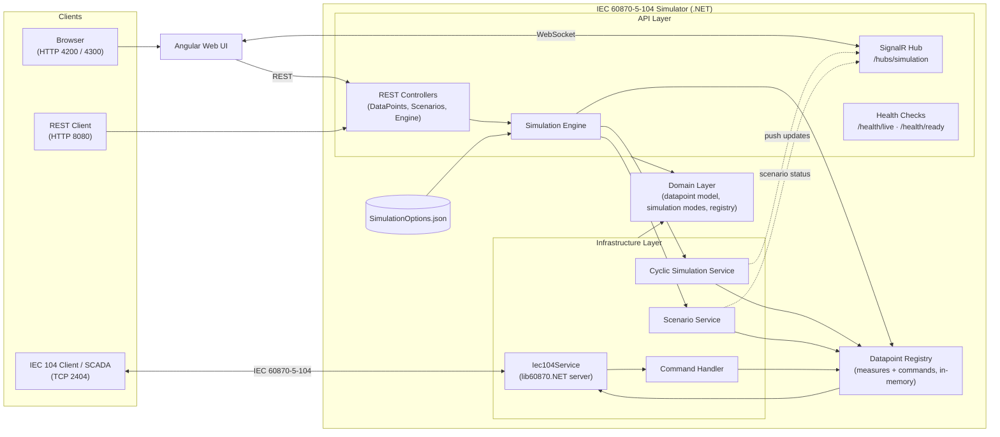

# Architecture

Detailed internal architecture of the IEC 60870-5-104 Simulator.

## Layers

- **API Layer** (`src/IEC60870-5-104-simulator.API`) — REST controllers, SignalR hub, health checks, and the simulation engine orchestration
- **Infrastructure Layer** (`src/IEC60870-5-104-simulator.Infrastructure`) — IEC 104 server (lib60870.NET), cyclic simulation, scenario execution, command handling
- **Domain Layer** (`src/IEC60870-5-104-simulator.Domain`) — datapoint model, simulation mode logic, and the `DatapointRegistry` that owns both measures and commands. No package dependencies.

## Datapoint ownership

`DatapointRegistry` is the single owner of datapoints: it holds the address uniqueness rule, the
value typing rule, and the command→response link. Readers get live references; every write goes
through a registry method. The rationale is recorded in
[ADR 0001](adr/0001-datapoint-registry.md).
