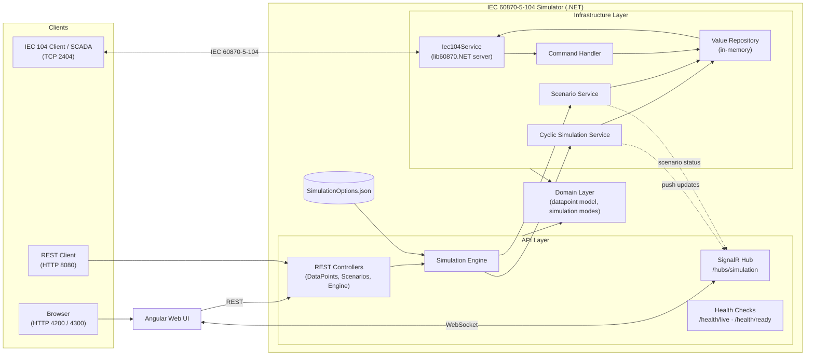

# Architecture

Detailed internal architecture of the IEC 60870-5-104 Simulator.

## Layers

- **API Layer** (`src/IEC60870-5-104-simulator.API`) — REST controllers, SignalR hub, health checks, and the simulation engine orchestration
- **Infrastructure Layer** (`src/IEC60870-5-104-simulator.Infrastructure`) — IEC 104 server (lib60870.NET), cyclic simulation, scenario execution, command handling, value storage
- **Domain Layer** (`src/IEC60870-5-104-simulator.Domain`) — datapoint model and simulation mode logic
